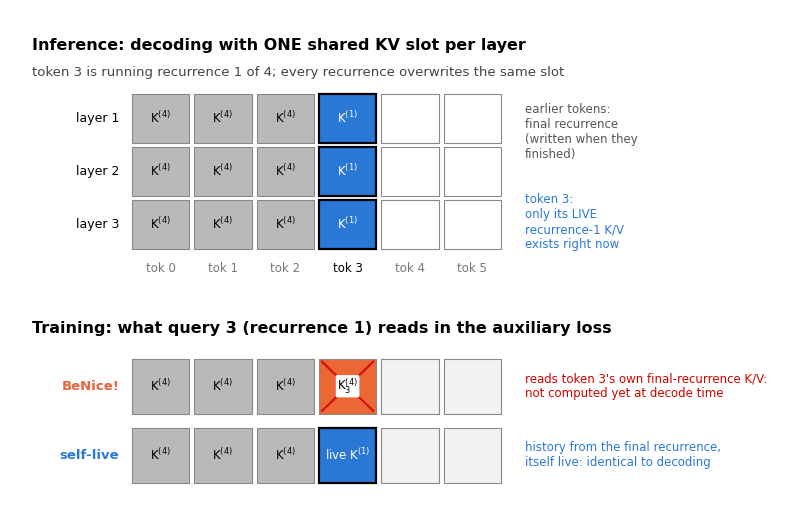
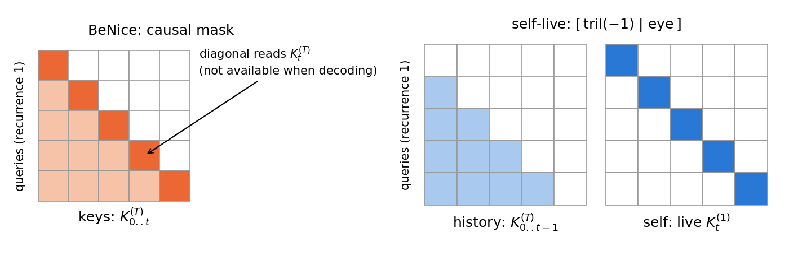
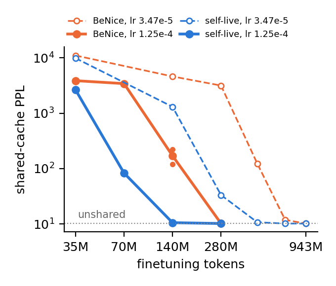
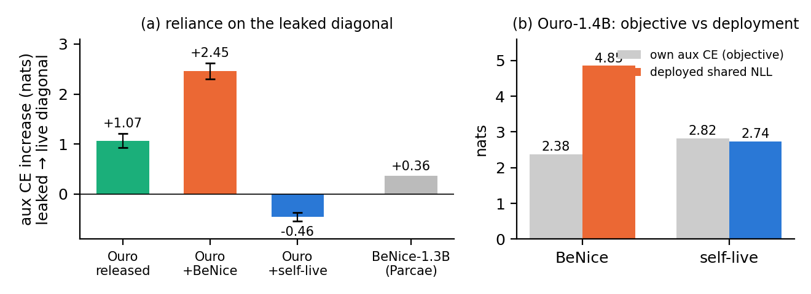

# Don't Peek at the Diagonal

**A one-column fix to BeNice!'s KV-sharing loss for looped language models**

*Yang Hu · November 2026 · code in this repo · paper coming to arXiv soon*



> **TL;DR.** [BeNice!](https://arxiv.org/abs/2610.31633) showed that a looped LM can keep **one** KV cache per layer, written by the final recurrence and read by every recurrence, and gave a simple post-training loss for it. We found one entry in that loss's auxiliary attention that never exists at decode time: each token reads **its own** final-recurrence key/value. Replacing just that diagonal with the token's *live* key/value (**self-live**) is a one-column change to the attention mask. With all recurrences unrolled and the history at its fixed point, the auxiliary pass then *is* shared-cache decoding. On Ouro-1.4B / 2.6B, the ACT-trained models where KV sharing breaks worst, self-live lifts the shared-cache 12-task macro from 15.3 / 23.3 (our port of BeNice!) to **47.0 / 59.7**, and needle retrieval to **98.9%**. On BeNice!'s own Parcae-1.3B setup it reaches lossless sharing at the stated 140M-token budget, where the original loss needs about 280M.

---

## First, a thank-you

This post is a follow-up to **BeNice! Closing Looping's Inference-Memory Gap via KV-Sharing** by Hayden Prairie, Jacob M. Ryan, Taylor Berg-Kirkpatrick and Daniel Y. Fu ([arXiv 2610.31633](https://arxiv.org/abs/2610.31633)). It is a paper we really enjoyed. It names the right property (*KV-shareability*: can the final recurrence's cache serve every recurrence?) and explains why stochastic-depth models have it (contractive residual dynamics). It pinpoints where sharing still fails on Parcae: a token-independent shift in the first layer of the first recurrence, which their "keep that one layer" fix repairs. It shows that sharing composes with KV quantization, MLA and KDA, and it comes with clean, released training and evaluation code.

Everything below builds directly on that work: their objective, their evaluation protocol, their Core suite and their Parcae training code. **We change one column of their auxiliary mask.** This would not exist without their paper and their code.

## The setup

A looped LM runs the same block of layers for `T` recurrences, so a conventional KV cache is indexed by (layer, recurrence) and grows `T`-fold. The natural remedy is to keep a single K/V per layer, the one written by the final recurrence, and let every recurrence read it. Released looped models are not trained for this and fall apart. Ouro-1.4B drops from 62.9 to 10.7 macro over 12 benchmarks, and Parcae-1.3B's perplexity rises by four orders of magnitude.

BeNice! post-trains with

```
L = CE(y, p^T) + γ · CE(y, p^(1←T))
```

where `p^(1←T)` runs the block once with **first-recurrence** queries and residuals but **final-recurrence** keys and values. Rather than unrolling shared-cache rollouts at training time, which BeNice! sets aside as too costly, the auxiliary term teaches early recurrences to read late-recurrence K/V.

## The one entry that does not exist

In the released implementation, the auxiliary attention uses an ordinary causal mask over the final-recurrence K/V. So query `t` reads keys `0..t`, **including `k_T[t]`, its own final-recurrence key**, a quantity computed from all `T` recurrences of token `t`.

A shared-cache decoder never has that entry. When token `t` runs its first recurrence, its later recurrences have not happened yet. What it actually reads is the final-recurrence K/V of tokens `< t` (already in the cache) plus **its own current, live K/V**.

That is the whole observation. Everything off the diagonal is already right.

## The fix: self-live



Keep the final-recurrence history, and let the diagonal read the live K/V of the current recurrence:

```python
# BeNice!: causal over [k_T]  ->  query t reads k_T[t], which decoding never has
y = sdpa(q, k_T, v_T, is_causal=True)

# self-live: [tril(-1) | eye] over [k_T | k_live]  ->  history from the final recurrence, itself live
mask = torch.cat([torch.ones(n, n, dtype=torch.bool).tril(-1),
                  torch.eye(n, dtype=torch.bool)], dim=1)
y = sdpa(q, torch.cat([k_T, k_live], -2), torch.cat([v_T, v_live], -2), attn_mask=mask)
```

Inference is unchanged. Training is about 9% slower per step (20.6 s vs. 18.8 s on 8 GPUs for Ouro-1.4B), because the two-part mask misses the fused causal kernel.

**It is exact, not just closer.** Unroll the auxiliary pass for all `T` recurrences and iterate its history to the fixed point (position `t` depends only on positions `< t`, so `n` sweeps suffice). The self-live auxiliary pass is then *exactly* token-by-token shared-cache decoding: the rollout objective BeNice! considered infeasible, obtained as a limit of the cheap one. We check this against our strict streaming decoder, an independent code path, in fp32:

| auxiliary pass vs. strict shared decoding | max \|logit diff\| | top-1 agreement |
|---|---|---|
| self-live, released Ouro-1.4B | 1e-3 | 100% |
| self-live, our trained Ouro-1.4B | 4e-5 | 100% |
| causal mask (BeNice!) | 16–22 | 2–4% |

[`self_live.py`](self_live.py) reproduces the same check on a tiny random looped transformer on CPU (`python self_live.py`): self-live matches shared decoding to 1e-15 in float64, while the causal mask does not (75% top-1 agreement even on a random toy model).

## What it buys

### Ouro: KV-shareability for an ACT-trained model

BeNice! evaluated released Ouro but did not post-train it (Ouro loses most of its quality under sharing, Core 54.57 → 25.17, which they attribute to Ouro's adaptive-computation-time objective). We ported their loss to Ouro and compared it with self-live under identical data and settings. Post-training: 140M tokens of mixed web / code / math data, γ = 0.1. The table shows the macro over 12 benchmarks (MMLU, MMLU-Pro, BBH, ARC-C, HellaSwag, WinoGrande, GSM8K, MATH500, HumanEval(+), MBPP(+)), all decoded strictly token by token, prompt included, under the cache being tested. KV sizes are for Ouro-1.4B at 2048 tokens.

| model | unshared (1536 MiB) | first2 (416 MiB) | shared (384 MiB) |
|---|---|---|---|
| Ouro-1.4B released | 62.9 | 46.8 | 10.7 |
| + BeNice! (our port) | 62.0 | 48.6 | 15.3 |
| + self-live | 61.8 | **50.6** | **47.0** |
| Ouro-2.6B released | 68.5 | 61.4 | 22.1 |
| + BeNice! (our port) | 69.0 | 60.3 | 23.3 |
| + self-live | 69.5 | **62.0** | **59.7** |

`first2` is BeNice!'s own observation put to work: keep the first layer's first-recurrence KV and share the rest.

On 2.6B with a shared cache, self-live beats the BeNice! port on all 12 tasks, and every paired 95% CI excludes zero. An independently sampled second post-training mix reproduces the 1.4B rows (shared macro 46.7 ± 0.4 vs. 15.2 ± 0.1).

**Needle retrieval** (RULER-style passkey / single / multikey, 2K–8K tokens, shared cache):

| | released | BeNice! (our port) | self-live |
|---|---|---|---|
| Ouro-1.4B | 12.7 | 60.7 | **98.9** |
| Ouro-2.6B | 41.8 | 54.2 | **98.9** |

So for these models, stochastic-depth pretraining is not necessary for KV-shareability: post-training with the right diagonal is enough.

### Is it really the diagonal?

We gave the BeNice! loss every other ingredient of our Ouro recipe: four auxiliary recurrences, a history iteration, γ = 0.1 and mixed data. Only the diagonal differs between the last two rows:

| Ouro-1.4B | unshared | shared | NIAH (shared) |
|---|---|---|---|
| BeNice! (our port) | 62.0 | 15.3 | 60.7 |
| BeNice! + our extras | 62.3 | 12.5 | 11.3 |
| self-live + our extras | 61.8 | **47.0** | **98.9** |

The shared-cache difference is +34.5 [33.3, 35.7], with all 12 tasks better. Without the fixed diagonal, the extras slightly hurt.

### Parcae-1.3B, BeNice!'s own setting

These runs use BeNice!'s config at its stated lr (1.25e-4); the two arms differ only in `aux`. The table shows the shared / unshared perplexity ratio at the end of training:

| finetuning tokens | BeNice! | self-live |
|---|---|---|
| 35M | 379 | 259 |
| 70M | 335 | **8.13** |
| 140M (BeNice!'s budget), seed 42 | 21.7 | **1.038** |
| 140M, seed 43 | 11.7 | **1.031** |
| 280M | 1.0020 | 1.0006 |



With BeNice!'s own evaluation code (Core, centered accuracy), the shared-minus-unshared gap at 140M is **−0.22** for self-live vs. −7.33 for BeNice!. At 280M both are lossless (−0.58 vs. −0.74). The advantage on Parcae is sample efficiency: BeNice! gets there too, it just needs about twice the tokens.

### Why Ouro so much more than Parcae?

The auxiliary CE is meant to be a cheap proxy for the deployed shared-cache CE. We evaluate the one-recurrence auxiliary pass twice, once with the leaked diagonal and once with the live one, on 16 WikiText-2 sequences.



- On released Ouro-1.4B the leaked entry is worth **1.07 nats**.
- BeNice! training more than doubles the reliance on it, to **2.45 nats**. Its objective falls to 2.38 nats while the deployed shared-cache NLL stays at 4.85, essentially its live-diagonal value (4.84). The loss is driven down through an entry the decoder never sees.
- Self-live's objective tracks deployment (2.82 vs. 2.74 nats).
- On the released BeNice!-1.3B (Parcae), the leak is worth only **0.36 nats**. That is a much weaker shortcut, which is why BeNice! still learns sharing on Parcae, only with more tokens.

## What we are *not* claiming

- KV-shareability, the loss, the first-layer analysis, `first2`, the composition with KV quantization and the evaluation protocol are **BeNice!'s**. Our contribution is the diagonal leak, self-live and its exactness, the Ouro post-training results, and the matched Parcae comparison.
- All BeNice! numbers on Ouro come from **our port** of their loss, since BeNice! did not post-train Ouro.
- On Ouro-1.4B a gap to the unshared cache remains (47.0 vs. 61.8 macro). At equal memory, plain 4-bit quantization of the unshared cache is better, so we see sharing as complementary to quantization, not a replacement.
- Post-training costs some MATH500 under the unshared cache, for both methods.
- On Parcae both methods are lossless from 280M tokens.
- Most configurations are single runs. The exceptions are two data draws for the Ouro-1.4B main recipe and two seeds at Parcae 140M.

## Code in this repo

| file | what |
|---|---|
| [`self_live.py`](self_live.py) | minimal, dependency-free (PyTorch only) reference: the mask, the auxiliary attention, the BeNice!-style loss, a strict shared-cache decoder, and the fixed-point equivalence check on a toy looped LM |
| [`parcae/recft-self-live.patch`](parcae/recft-self-live.patch) | ~30-line patch adding `aux: swap_ce_self_live` to the official BeNice!/Parcae code ([sandyresearch/parcae](https://github.com/sandyresearch/parcae), `recft/`, commit `4b86c2a`) |
| [`parcae/configs/`](parcae/configs) | the 140M-token configs for both arms (they differ only in `aux`) |
| [`ouro/ouro_benice_model.py`](ouro/ouro_benice_model.py) | the Ouro objective: `CE(p^T) + γ·CE(aux)` with `aux_self_live`, auxiliary recurrences and history iterations |

```bash
# toy equivalence check (CPU)
python self_live.py

# Parcae: apply the patch to the official code, then train with the self-live config
git clone https://github.com/sandyresearch/parcae && cd parcae && git checkout 4b86c2a
git apply /path/to/benice-self-live/parcae/recft-self-live.patch
# set model / train_dir / val_dir in parcae/configs/parcae-1.3b-140m-swap_ce_self_live.yaml
```

```python
# Ouro: wrap a loaded model and train on the returned total loss
from ouro_benice_model import OuroBeNiceObjective
objective = OuroBeNiceObjective(model, gamma=0.1, aux_self_live=True,
                                aux_rounds=4, aux_history_iterations=1)
total, ce, aux = objective(input_ids)
```

The full experiment code (strict streaming evaluation with `full` / `shared` / `first2` caches, the 12-task suite, NIAH, Core runs, analysis scripts) will be released with the paper.

## Citation

If you find this useful, please cite BeNice! first: it is the work this builds on.

```bibtex
@misc{prairie2026benice,
  title         = {{BeNice}! {Closing} Looping's Inference-Memory Gap via {KV}-Sharing},
  author        = {Hayden Prairie and Jacob M. Ryan and Taylor Berg-Kirkpatrick and Daniel Y. Fu},
  year          = {2026},
  eprint        = {2610.31633},
  archivePrefix = {arXiv},
  url           = {https://arxiv.org/abs/2610.31633}
}

@misc{hu2026selflive,
  title        = {Don't Peek at the Diagonal: Training Looped Language Models for Cross-Recurrence {KV} Sharing},
  author       = {Yang Hu},
  year         = {2026},
  howpublished = {\url{https://github.com/yanghu819/benice-self-live}},
  note         = {Blog post and code; arXiv preprint forthcoming}
}
```

We also build on Ouro and Parcae:

```bibtex
@misc{zhu2025ouro,
  title         = {Scaling Latent Reasoning via Looped Language Models},
  author        = {Rui-Jie Zhu and others},
  year          = {2025},
  eprint        = {2510.25741},
  archivePrefix = {arXiv},
  url           = {https://arxiv.org/abs/2510.25741}
}

@misc{prairie2026parcae,
  title         = {Parcae: Scaling Laws For Stable Looped Language Models},
  author        = {Hayden Prairie and Zachary Novack and Taylor Berg-Kirkpatrick and Daniel Y. Fu},
  year          = {2026},
  eprint        = {2604.12946},
  archivePrefix = {arXiv},
  url           = {https://arxiv.org/abs/2604.12946}
}
```

GitHub's **"Cite this repository"** button (from [`CITATION.cff`](CITATION.cff)) gives the same entry in APA and BibTeX.

## License

MIT. The Parcae patch modifies [sandyresearch/parcae](https://github.com/sandyresearch/parcae), which is also MIT-licensed.
